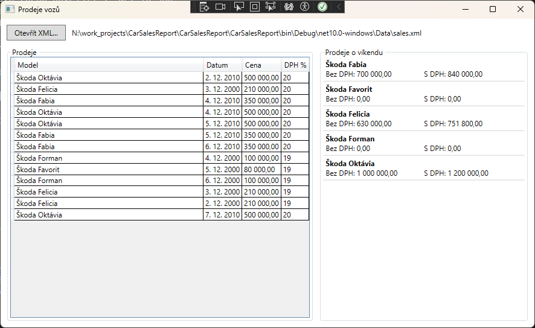

# CarSalesReport

Desktopová aplikace ve WPF (C#, .NET 10), která načte prodeje vozů ze souboru XML, zobrazí je v tabulce a pro každý model spočítá celkovou cenu vozů prodaných o víkendu – bez DPH a s DPH.

Praktický úkol pro pozici Programátor C#.



## Spuštění

1. Visual Studio 2026 (nebo novější) s .NET 10 SDK.
2. Otevřít `CarSalesReport.slnx`, jako spouštěcí projekt nastavit `CarSalesReport` a spustit (F5).
3. Kliknout na **Otevřít XML…** – dialog se otevře ve složce `Data` vedle programu, kde je vzorový soubor `sales.xml`.

Testy: **Test → Run All Tests** ve Visual Studiu, nebo `dotnet test` ve složce řešení.

## Struktura řešení

| Projekt | Obsah |
|---|---|
| `CarSalesReport.Core` | Model `Sale`, načtení XML (`SalesReader`), výpočet víkendových součtů (`SalesCalculator`). Bez závislosti na WPF. |
| `CarSalesReport` | Okno WPF: výběr souboru, tabulka prodejů, víkendové součty. |
| `CarSales.Tests` | Testy xUnit výpočtu a vzorového souboru. |

Logika je oddělená od okna, aby se dala testovat bez spouštění aplikace a použít i jinde (např. ve webovém API).

## Formát XML

```xml
<?xml version="1.0" encoding="utf-8"?>
<sales>
  <sale>
    <model>Škoda Oktávia</model>
    <date>2010-12-02</date>
    <price>500000</price>
    <DPH>20</DPH>
  </sale>
  ...
</sales>
```

- `date` – datum ve formátu ISO 8601 (RRRR-MM-DD), aby se četlo stejně na každém počítači.
- `price` – cena bez DPH, bez oddělovačů tisíců.
- `DPH` – sazba v procentech.

Čísla a data se čtou s `CultureInfo.InvariantCulture`, zobrazují se v české kultuře (`1 000 000,00`).

## Rozhodnutí

- **DPH se počítá u každého prodeje zvlášť** (`Sale.TotalPrice`), teprve potom se sčítá. Škoda Felicia má o víkendu prodeje s DPH 20 % i 19 %, výsledek s DPH je proto 751 800,00, ne 630 000 × jedna sazba.
- **Peníze jsou v `decimal`**, ne v `double`. Zadání uvádí double, ale `double` neukládá desetinná čísla přesně a pro peníze se nehodí.
- **Zobrazují se všechny modely**, i ty, které o víkendu prodány nebyly (součet 0,00). Zadání říká „pro každý model“ a nulový řádek uživateli říká, že prodeje byly, jen ne o víkendu.
- **Víkend** = sobota nebo neděle podle `DayOfWeek`.
- Pokud soubor nejde načíst (poškozené XML, chybějící hodnota, špatný formát), aplikace nespadne, ale zobrazí chybovou hlášku.

## Výsledek pro vzorová data

| Model | Cena bez DPH | Cena s DPH |
|---|---:|---:|
| Škoda Fabia | 700 000,00 | 840 000,00 |
| Škoda Favorit | 0,00 | 0,00 |
| Škoda Felicia | 630 000,00 | 751 800,00 |
| Škoda Forman | 0,00 | 0,00 |
| Škoda Oktávia | 1 000 000,00 | 1 200 000,00 |

Tyto hodnoty ověřuje test `SampleFile_ExpectedWeekendsTotal`.